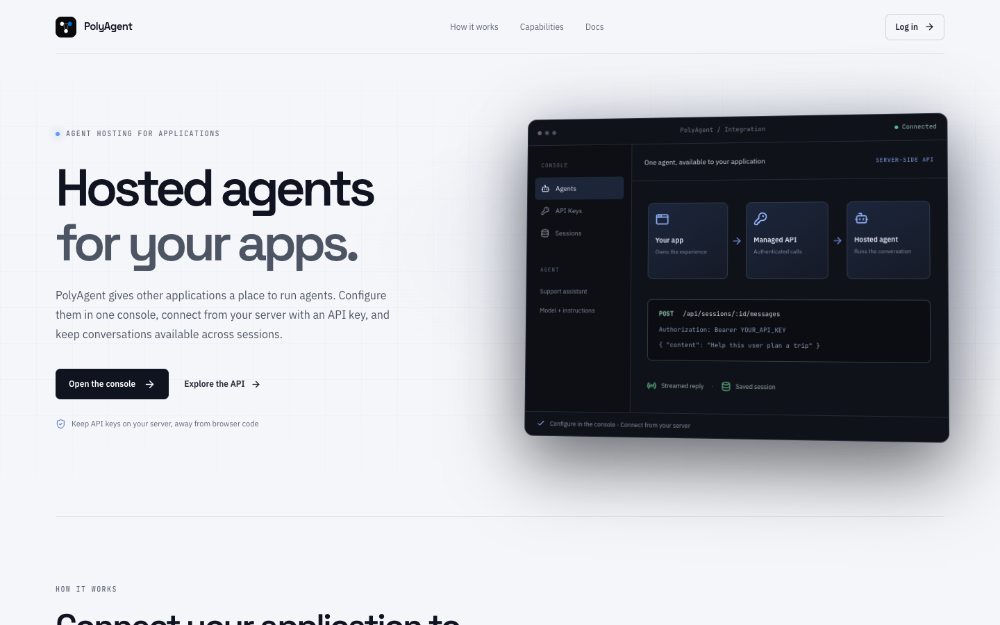

<div align="center">
  
  <h1>PolyAgent</h1>
  <p><strong>Build an agent once. Use it from the console, CLI, or your application.</strong></p>
  <h2><a href="https://managed-agents.colab.duke.edu/">🚀 Open PolyAgent →</a></h2>
  <p><a href="https://duke-ece.github.io/managed-agents-docs/">📖 Read the documentation →</a></p>
</div>

PolyAgent is an agent platform developed across the [Duke-ECE](https://github.com/Duke-ECE) repositories. Users configure reusable agents, start conversations, stream replies, and return to saved sessions. Applications can call hosted agents through an HTTP API or TypeScript SDK. Agent tools run in isolated sandboxes when the sandbox integration is enabled.

[](https://managed-agents.colab.duke.edu/)

## Explore PolyAgent

| Start here | What you can do |
| --- | --- |
| [Web console](https://managed-agents.colab.duke.edu/) | Sign in, configure agents, chat, and create API keys. |
| [Documentation](https://duke-ece.github.io/managed-agents-docs/) | Find setup guides, API examples, and architecture references. |
| [Developer guide](https://duke-ece.github.io/managed-agents-docs/developers/) | Connect an application to a hosted agent. |
| [API guide](https://duke-ece.github.io/managed-agents-docs/developers/api-guide) | Create sessions and consume streamed responses. |
| [CLI](https://github.com/Duke-ECE/managed-agents-cli) | Manage agents and conversations from a terminal. |
| [TypeScript SDK](https://github.com/Duke-ECE/managed-agents-sdk) | Call the chat API from a Node.js server. |

The platform currently runs as a project deployment. Access to the platform-provided LLM is limited to approved accounts; you can configure an agent with your own compatible LLM provider.

## Quick start

1. [Sign in to the console](https://managed-agents.colab.duke.edu/console) and create or clone an agent. Set its instructions, model, and allowed tools. The built-in assistant requires platform LLM access; otherwise configure an agent with your own provider key.
2. Open [Chat](https://managed-agents.colab.duke.edu/chat), select your agent, and send a message. PolyAgent saves the session so you can continue it later.
3. To use the agent from an application, create an [API key](https://managed-agents.colab.duke.edu/keys), keep it on your server, and follow the [developer guide](https://duke-ece.github.io/managed-agents-docs/developers/) to start a session and stream replies.

## Set up a development workspace

This repository also provides an entry point for coding agents working across the PolyAgent repositories. See [workspace initialization](workspace/README.md) for the public repository list, optional private checkouts, and verification steps.

Give your coding agent this prompt:

```text
Clone https://github.com/L-Rocket/PolyAgent.git and use the cloned repository directory as the workspace root. First read the root AGENTS.md and workspace/README.md, then run scripts/init-workspace.sh. Verify each child repository's remote and branch, as well as the .agents/skills/ symlinks. Do not commit child repositories, credentials, or machine-specific configuration. When finished, report the initialization results and any repository access I need to provide.
```

The default manifest includes public repositories. Additional repositories can be listed locally when you have access to them.

## Architecture


This [two-cluster architecture diagram](https://github.com/Duke-ECE/managed-agents-design/blob/main/requirements/0005-cubesandbox-integration/two-clusters.png) shows the target separation between the platform services and CubeSandbox session MicroVMs. It uses the project's earlier “Managed Agents” name. The current CubeSandbox integration is a bounded development pilot; the dedicated multi-node Cube cluster and durable sandbox lifecycle shown here are **not yet generally available**. See the [architecture guide](https://duke-ece.github.io/managed-agents-docs/architecture) for the implemented request flow and the [CubeSandbox design](https://github.com/Duke-ECE/managed-agents-design/tree/main/requirements/0005-cubesandbox-integration) for rollout status.

## Main repositories

PolyAgent is a collection of independently versioned repositories. Existing technical repository names remain `managed-agents-*` for compatibility.

| Repository | Role |
| --- | --- |
| [Frontend](https://github.com/Duke-ECE/managed-agents-frontend) | React console and chat interface. |
| [Agent runtime](https://github.com/Duke-ECE/agent-runtime) | Runs agent sessions and streams model responses. |
| [Session manager](https://github.com/Duke-ECE/session-manager) | Owns durable sessions, transcripts, and access checks. |
| [Sandbox manager](https://github.com/Duke-ECE/sandbox-manager) | Manages isolated tool execution. |
| [CLI](https://github.com/Duke-ECE/managed-agents-cli) | Terminal client. |
| [TypeScript SDK](https://github.com/Duke-ECE/managed-agents-sdk) | Server-side application integration. |
| [SDK example](https://github.com/Duke-ECE/managed-agents-sdk-example) | Minimal integration example. |
| [Protobuf contracts](https://github.com/Duke-ECE/protos) | Shared gRPC service definitions. |
| [Documentation](https://github.com/Duke-ECE/managed-agents-docs) | Developer and operator guides. |
| [Design records](https://github.com/Duke-ECE/managed-agents-design) | Cross-repository requirements and decisions. |

The API gateway and mobile application repositories are currently private and are not part of this public source index. Public repositories have their own licensing and contribution terms; this repository's MIT license does not change them.

## Learn more

- [Developer quick start](https://duke-ece.github.io/managed-agents-docs/developers/)
- [API reference and examples](https://duke-ece.github.io/managed-agents-docs/developers/api-guide)
- [Platform architecture](https://duke-ece.github.io/managed-agents-docs/architecture)
- [Deployment and operations](https://duke-ece.github.io/managed-agents-docs/deployment)
- [Product changelog](https://duke-ece.github.io/managed-agents-docs/changelog)

## License

This overview repository is licensed under the [MIT License](LICENSE). Each linked repository retains its own license and visibility.
