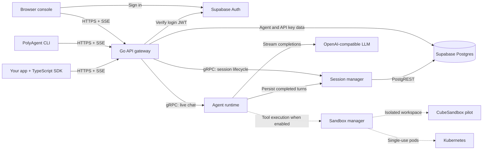

# PolyAgent

**Build an agent once. Use it from the console, CLI, or your application.**

PolyAgent is an agent platform developed across the [Duke-ECE](https://github.com/Duke-ECE) repositories. Users configure reusable agents, start conversations, stream replies, and return to saved sessions. Applications can call hosted agents through an HTTP API or TypeScript SDK. Agent tools run in isolated sandboxes when the sandbox integration is enabled.

## Explore PolyAgent

| Start here | What you can do |
| --- | --- |
| [Web console](https://managed-agents.colab.duke.edu/) | Sign in, configure agents, chat, and create API keys. |
| [Developer guide](https://duke-ece.github.io/managed-agents-docs/developers/) | Connect an application to a hosted agent. |
| [API guide](https://duke-ece.github.io/managed-agents-docs/developers/api-guide) | Create sessions and consume streamed responses. |
| [CLI](https://github.com/Duke-ECE/managed-agents-cli) | Manage agents and conversations from a terminal. |
| [TypeScript SDK](https://github.com/Duke-ECE/managed-agents-sdk) | Call the chat API from a Node.js server. |

The platform currently runs as a project deployment. Access to the platform-provided LLM is limited to approved accounts; you can configure an agent with your own compatible LLM provider.

## Architecture

Active agent sessions live in the runtime. Session records and transcripts are stored through the session manager, allowing the runtime to hydrate a session after a restart or idle eviction. The sandbox manager supports a bounded CubeSandbox development pilot; isolated execution is not enabled for every deployment. See the [architecture guide](https://duke-ece.github.io/managed-agents-docs/architecture) for the current request flow and its limits.

## Main repositories

PolyAgent is a collection of independently versioned repositories. Existing technical repository names remain `managed-agents-*` for compatibility.

| Repository | Role |
| --- | --- |
| [Frontend](https://github.com/Duke-ECE/managed-agents-frontend) | React console and chat interface. |
| [Agent runtime](https://github.com/Duke-ECE/agent-runtime) | Runs agent sessions and streams model responses. |
| [Session manager](https://github.com/Duke-ECE/session-manager) | Owns durable sessions, transcripts, and access checks. |
| [Sandbox manager](https://github.com/Duke-ECE/sandbox-manager) | Manages isolated tool execution. |
| [CLI](https://github.com/Duke-ECE/managed-agents-cli) | Terminal client. |
| [TypeScript SDK](https://github.com/Duke-ECE/managed-agents-sdk) | Server-side application integration. |
| [SDK example](https://github.com/Duke-ECE/managed-agents-sdk-example) | Minimal integration example. |
| [Protobuf contracts](https://github.com/Duke-ECE/protos) | Shared gRPC service definitions. |
| [Documentation](https://github.com/Duke-ECE/managed-agents-docs) | Developer and operator guides. |
| [Design records](https://github.com/Duke-ECE/managed-agents-design) | Cross-repository requirements and decisions. |

The API gateway and mobile application repositories are currently private and are not part of this public source index. Public repositories have their own licensing and contribution terms; this repository's MIT license does not change them.

## Learn more

- [Developer quick start](https://duke-ece.github.io/managed-agents-docs/developers/)
- [API reference and examples](https://duke-ece.github.io/managed-agents-docs/developers/api-guide)
- [Platform architecture](https://duke-ece.github.io/managed-agents-docs/architecture)
- [Deployment and operations](https://duke-ece.github.io/managed-agents-docs/deployment)
- [Product changelog](https://duke-ece.github.io/managed-agents-docs/changelog)

## License

This overview repository is licensed under the [MIT License](LICENSE). Each linked repository retains its own license and visibility.
